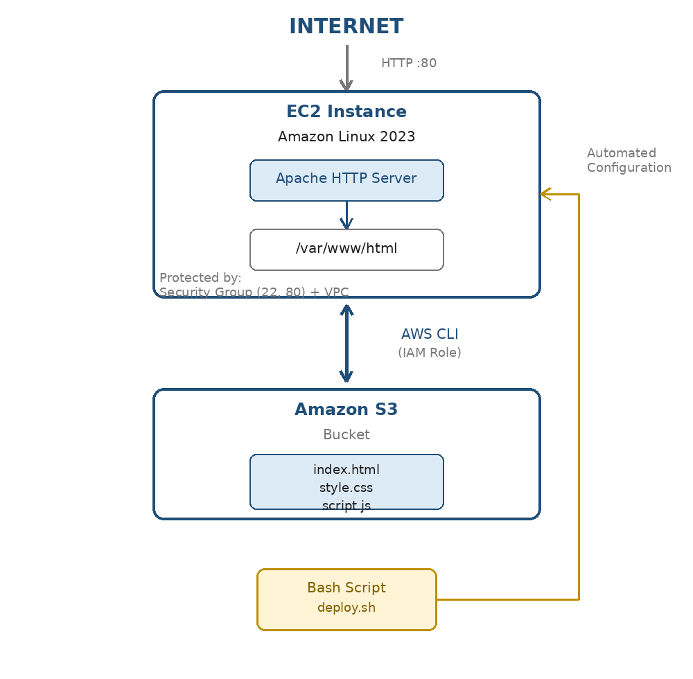
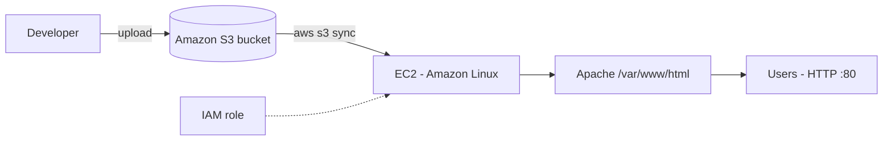

# Automated Linux Web Server Deployment (AWS EC2 + Bash + S3)

A repeatable deployment pipeline: website files live in **Amazon S3**, and a custom Bash script (`deploy.sh`) on an **EC2** instance installs Apache and syncs the latest content with the **AWS CLI** - one command, consistent result.





## What `deploy.sh` does
```
[1/5] Updating packages...
[2/5] Installing Apache...
[3/5] Starting and enabling Apache service...
[4/5] Syncing website content from S3...
[5/5] Deployment complete. Logging results...
```
Logs are written to `/var/log/webserver-deployment.log`. Run it with `sudo ./deploy.sh`.

## AWS setup
- **Region:** eu-central-1 (Frankfurt), custom VPC
- **Security Group:** SSH 22 and HTTP 80
- **IAM:** permissions such as `s3:GetObject` and `s3:ListBucket` so the instance can read the bucket without hard-coded access keys
- **Content sync:** `sudo aws s3 sync s3://<your-bucket> /var/www/html/`

## Tech stack
EC2 | S3 | IAM | VPC | Security Groups | Linux | Bash | Apache | AWS CLI | HTML/CSS/JS

## Troubleshooting log
| Problem | Cause and fix |
|---|---|
| `syntax error near unexpected token` | HTML typed directly into the shell; write it to a file with an editor or `tee` |
| `Permission denied` writing to `index.html` | `>>` does not inherit sudo; use `sudo tee -a` |
| Script needs superuser privileges | Run `sudo ./deploy.sh` |
| Deployment log file missing | Script had exited early; created after a successful run |

## Repository contents
- `images/` - architecture diagram and screenshots of the live site and script run
- `report/` - full project report

## Future scope
ALB + Auto Scaling, CI/CD (GitHub Actions / Jenkins / CodeDeploy), HTTPS, CloudWatch logs, Terraform.

## Author
**Atharva Vadage** - [GitHub](https://github.com/Atharva72218)
